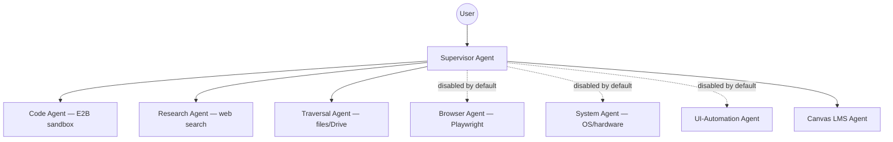

# Chad — AI Assistant

**Chad is an experimental Windows desktop assistant for local AI models.**

## Download Chad for Windows

**[Download the Windows installer (.exe) — v0.2.0-alpha.9](https://github.com/MatthewLoyed/Chad/releases/download/v0.2.0-alpha.9/Chad-Setup-0.2.0-alpha.9.exe)**

Download and run `Chad-Setup-0.2.0-alpha.9.exe`. No Python or Node installation
is required. A local model server and model are installed separately.
[Release notes, checksums and other downloads](https://github.com/MatthewLoyed/Chad/releases/tag/v0.2.0-alpha.9).

Start with Chat mode for conversation, summaries and rewrites. Specialist tools,
connected services, browser and system capabilities require additional setup;
they are outside this alpha's verified Chat scope.

This is a personal project with a public **experimental alpha**. Expect bugs, model-dependent
results, and unfinished features. There is no support SLA or promised roadmap.
Start with harmless tasks in a test folder before granting access to important
files or connected accounts.

Chat history and memory use local storage by default. Web searches, configured
cloud models, integrations, and optional tracing can send data to external
services. Review [`docs/guides/PRIVATE_DATA.md`](docs/guides/PRIVATE_DATA.md)
and [`docs/SECURITY_POSTURE.md`](docs/SECURITY_POSTURE.md) before enabling them.

Chad is a desktop GUI (the **Limb**) paired with a headless Python server (the
**Brain**) that talks to it over WebSocket. The Brain does the thinking
(routing, tools, memory); the Limb is a thin client that also drives local
hardware (mouse/keyboard, screen, volume) the Brain can't reach directly. One
Brain can serve multiple Limbs. Under the hood it's a supervisor-led team of
specialist agents (LangGraph), with local-first model routing (LM Studio/Ollama
or cloud) and a RAG-based tool selector so the right tools get injected
per-request instead of dumping the whole registry into context every turn.

---

## Download (Windows)

Windows installers are distributed through
[GitHub Releases](https://github.com/MatthewLoyed/Chad/releases)
— no Python or `npm` required for the installer.

You also need a separately installed local model server, such as LM Studio or
Ollama, and a model. Agent mode additionally needs model/tool compatibility.
Model downloads are separate from the installer. RAM, GPU memory, and response speed depend on the model and its
quantization; see the release notes for configurations actually tested.
No cloud API key or Supabase account is required for the local chat path.

**Updates:** installer users download and run the next installer manually.
Automatic updates are off. The in-app **Update Chad** action is intended for
source checkouts with Git; it does not upgrade this packaged alpha.
Reinstalling retains local data; back up important configuration and chats first.

On first launch, choose your model backend, test the connection, select a model
and finish setup. Start with **Chat** mode for ordinary conversation, summaries
and rewrites. Agent mode and optional connectors need additional setup.

Clean-Windows testing uses a small Qwen3-0.6B Q8 CPU model served by llama.cpp
inside an 8 GB / four-vCPU VM. This is a functional Chat smoke test, not a speed
benchmark or verification of larger models, GPU inference or every specialist.

Run the installer, then launch Chad from the Desktop or Start Menu shortcut
it creates. It installs both the Limb and the headless Brain; the Limb
auto-starts the Brain on launch if one isn't already running. First launch
may show a Windows SmartScreen warning since the installer isn't code-signed
yet (#430) — click **More info → Run anyway**. See
[`packaging/README.md`](packaging/README.md) for how this is built.

## Quickstart (source checkout)

Prefer running from source, or contributing? Follow
[`docs/setup/COLD_START.md`](docs/setup/COLD_START.md) — clone → venv →
`config/secrets.yaml` → running Brain + GUI, fully walked through, including
the zero-Supabase local-only fallback (no cloud account required to try it).
For the day-to-day dev loop (three terminals: Brain, GUI, Vite), see
[`CLAUDE.md.example`](CLAUDE.md.example).

---

## What's actually enabled by default

The table describes the tracked **development configuration**, not an assurance
about an installed release. Check the configuration at the release tag for a
packaged build; local preferences may override it. See
[`config/config.yaml`](config/config.yaml) for `disabled_subagents`, `planner`,
and `voice_mode`.

| Capability | Development default | Notes |
|---|---|---|
| Code, research and file traversal specialists | On | Tools still need their own backend/API configuration. |
| Canvas LMS specialist | On | Requires its connector setup. |
| Semantic tool selection | On | Relevant tools are shortlisted per turn. |
| Voice mode | Off, opt-in | Requires local audio dependencies and hardware. |
| Browser, system and UI automation specialists | Off | Enable deliberately in effective configuration. |
| Multi-step planner | On, experimental | Enabled for hardening; plan validation is currently off. |
| Autonomous background activity | Off, opt-in | Enable deliberately in Settings → Automations. |
| Explicit memory save/forget tools | Require approval | Review the proposed fact in the desktop app before it is changed. |

Communication tools are not a separate registered specialist. Consult the
[current roster](docs/architecture/HIERARCHICAL_AGENTS.md) before extending it.

---

## Architecture

Contributors and coding agents: start with the [task map](docs/architecture/END_TO_END.md#find-the-existing-implementation)
and [shared guidance](AGENTS.md).



Each specialist is a compiled LangGraph ReAct agent (`src/core/orchestration/agents/factory.py`)
scoped to a tool domain, with its own persona prompt (a local persona fragment —
see [`docs/architecture/PERSONA_PROMPTS.md`](docs/architecture/PERSONA_PROMPTS.md))
and optionally a pinned local model. The
Supervisor delegates single-turn work to whichever specialists are enabled;
see [`docs/architecture/HIERARCHICAL_AGENTS.md`](docs/architecture/HIERARCHICAL_AGENTS.md)
for the full design and [`docs/architecture/DUALITY_GUIDE.md`](docs/architecture/DUALITY_GUIDE.md)
for the Brain/Limb split.

### Local AI support

Chad supports running local LLMs via **LM Studio**, **Ollama**, or any raw
OpenAI-compatible endpoint (**llama.cpp `server`**, **vLLM**) — no cloud API
key required for the core loop:

| Backend | Default URL | Notes |
|---|---|---|
| LM Studio | `http://localhost:1234/v1` | Recommended; UI-based model management. |
| Ollama | `http://localhost:11434/v1` | Recommended for CLI-native/lightweight serving. |
| llama.cpp `server` / vLLM | whatever you start it on | Config-only, no code changes — see below. |

Configured under `local_models` in `config/config.yaml` /
`config/preferences.yaml` (no `.env` toggle). The setup wizard's backend
chooser walks you through picking one; Chad auto-discovers running local
models in the GUI's model dropdown and verifies tool-calling support per
model. See [`docs/features/LOCAL_MODELS.md`](docs/features/LOCAL_MODELS.md)
for the full config shapes for each backend.

### Memory & persona

Persona config, long-term memory, and activity RAG are **local by default** —
persona lives in Markdown files (`prompts/persona/`, `config/persona/`) and
personal graph facts live in `data/knowledge_graph.json`, while activity RAG and
local database records use SQLite (`data/local_chad.db`), with
embeddings generated and searched entirely on-device. Supabase is an
**optional opt-in** layer (set `SUPABASE_URL`/`SUPABASE_ANON_KEY`) for
cross-device sync of persona and knowledge-graph facts only — bulk activity
data (Chrome, Gmail, filesystem, Drive) always stays local regardless. See
[`docs/setup/LOCAL_FIRST.md`](docs/setup/LOCAL_FIRST.md) for the full
local/Supabase status matrix and
[`docs/guides/PRIVATE_DATA.md`](docs/guides/PRIVATE_DATA.md) for what stays
local either way.

### Monitoring

All agent turns, tool calls, and reasoning are traced via
[LangSmith](https://smith.langchain.com/) when `LANGSMITH_API_KEY` is set
(`.env.example`). To audit which tools are registered per agent domain:

```powershell
.venv\Scripts\python tests/manual/check_agent_tools.py
```

---

## Roadmap / experimental

These exist in the codebase and work, but aren't part of the default
experience yet — either disabled pending more vetting, or genuinely
unfinished:

- **Browser automation** (Playwright, DOM-aware Set-of-Mark navigation) and
  **UI/system/communication agents** — see the table above; enable per-agent
  in `config/config.yaml` once you've reviewed the safeguards in
  `docs/features/BROWSER_AUTOMATION.md`.
- **Multi-step planner** — enabled for development hardening (`planner.enabled: true`);
  still experimental. Check the release tag and effective preferences before use.
- **Voice mode** — local wake-word → STT → TTS pipeline; see
  `docs/features/` for setup.
- **Auto-update channel for the packaged installer** — the Brain
  self-updates via Settings → System → "Update Chad"; a binary auto-update
  channel for the installer itself is out of scope for now (#180).
- **Cross-platform Limbs** (iOS/Android) — not started.

---

## Project structure

- `src/core/` — orchestration (LangGraph supervisor + specialist agents), AI
  engines, session/memory management.
- `src/clients/` — desktop GUI (WebView2 + React) and its API bridge.
- `src/tools/` — categorized tool library (web, system, coding, workspace…).
- `src/skills/` — progressive-disclosure `SKILL.md` expertise + optional
  subagent executors.
- `src/remote/` — Brain/Limb WebSocket protocol, server and client.
- `src/shared/` — shared utilities, logging, config management.
- `config/` — `config.yaml`, `preferences.yaml`, and templates for the
  gitignored local files (`secrets.yaml`, `personal_knowledge.md`).
- `docs/` — architecture, feature, and setup guides.
  - Newcomer setup: [`docs/setup/COLD_START.md`](docs/setup/COLD_START.md),
    [`docs/setup/PERSONAL_KNOWLEDGE.md`](docs/setup/PERSONAL_KNOWLEDGE.md),
    [`docs/setup/BROWSER_HISTORY.md`](docs/setup/BROWSER_HISTORY.md).

More detail:
- Security posture & threat model — [`docs/SECURITY_POSTURE.md`](docs/SECURITY_POSTURE.md)
- End-to-end walkthrough (plain-language + technical) — [`docs/architecture/END_TO_END.md`](docs/architecture/END_TO_END.md)
- Tool inventory — [`docs/architecture/TOOLS_ORGANIZATION.md`](docs/architecture/TOOLS_ORGANIZATION.md)
- Hierarchical agent design — [`docs/architecture/HIERARCHICAL_AGENTS.md`](docs/architecture/HIERARCHICAL_AGENTS.md)
- Skill system — [`docs/architecture/skill-system.md`](docs/architecture/skill-system.md)
- Local model config — [`docs/features/LOCAL_MODELS.md`](docs/features/LOCAL_MODELS.md)
- Bootstrap sequence — [`docs/architecture/SYSTEM_BOOTSTRAP.md`](docs/architecture/SYSTEM_BOOTSTRAP.md)
- Releasing a new version — [`docs/RELEASING.md`](docs/RELEASING.md)
- Superseded design docs & implementation plans — [`docs/archive/`](docs/archive/)

## Contributing

See [`CONTRIBUTING.md`](CONTRIBUTING.md) and
[`docs/guides/DEV_WORKSPACE.md`](docs/guides/DEV_WORKSPACE.md).
