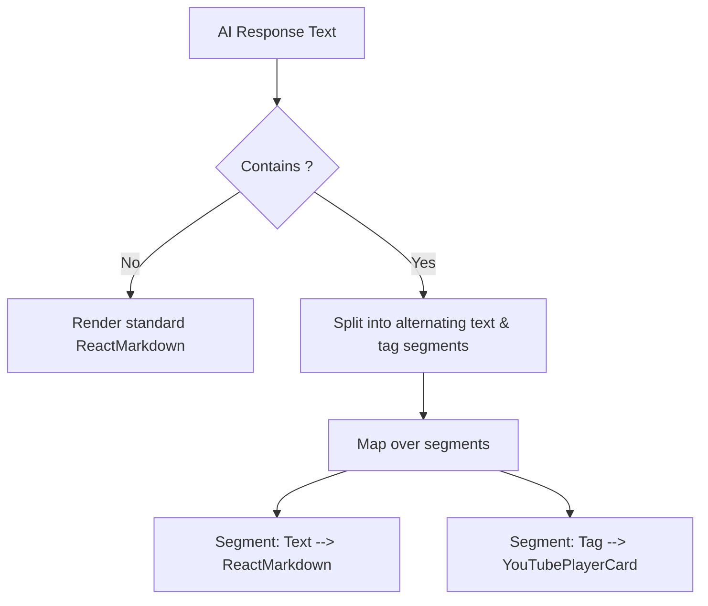

# YouTube Inline Player Design Specification

This document details the visual design, interactive behaviors, and frontend architecture for rendering a premium, inline YouTube video player directly within CHAD's chat bubbles.

## 1. Executive Summary

- **Goal**: Enable CHAD to render interactive YouTube video player cards inline inside chat messages when presenting recommendations, history search results, or links.
- **Approach**: Integrated **Segmented Markdown Parser** combined with a custom React **`<YouTubePlayerCard>`** component.
- **Key Design Philosophy**: High-performance (lazy-load iframe only when clicked), premium dark glassmorphism styling, clean vertical stack layout, and zero external dependency footprint.

---

## 2. Interface Tag Syntax

CHAD will output the inline player using a clean, custom XML-like tag:

```xml
<youtube id="dQw4w9WgXcQ" title="Rick Astley - Never Gonna Give You Up" />
```

### Attributes:
- `id` (required): The unique YouTube 11-character video ID.
- `title` (required): The title of the video to display in the card header.

---

## 3. Architecture & Parsing Flow

We use a **Hybrid Segmented Renderer** in `MarkdownMessage.tsx` to handle parsing and rendering safely without the security vulnerabilities and bundle bloat of standard HTML-in-markdown parsers (`rehype-raw`):



### 1. Regex Splitter
A robust regex matches the `<youtube>` tag and parses its attributes:
```typescript
const youtubeRegex = /<youtube\s+id="([^"]+)"\s+title="([^"]+)"\s*\/>/g;
```

### 2. Segmented Rendering
Split the raw AI output and render standard markdown segments or the custom component in their exact output sequence, maintaining flawless layout flow.

---

## 4. Visual & Interaction Design

The `<YouTubePlayerCard>` uses a widescreen `aspect-ratio: 16/9` responsive layout.

### A. Preview State (`isPlaying === false`)
- **Card Container**: Glassmorphic dark styling (`backdrop-filter: blur(16px)`), thin semi-transparent borders, and a subtle pulsing neon-red shadow.
- **Top Header**: Minimal top row showing a glowing red YouTube icon, creator name (if available), and the video title.
- **Large Widescreen Thumbnail**: High-quality video thumbnail dynamically fetched from YouTube's public image server:
  `https://img.youtube.com/vi/${id}/maxresdefault.jpg` (automatically falling back to `/hqdefault.jpg` if needed).
- **Hover Glow Overlay**: Hovering on the card reveals a glassy dark overlay with a glowing, red play button in the center.

### B. Playback State (`isPlaying === true`)
- **Interactive Player**: When clicked, the preview swaps instantly with an embedded YouTube `<iframe>` player containing `autoplay=1&rel=0`.
- **Muted Control Header**: A clean, semi-transparent top header bar stays visible above the video, housing:
  - The video title on the left.
  - A beautiful close `(X)` button on the right.
- **Instant Collapse**: Clicking the `(X)` button immediately stops video playback (destroying the iframe) and restores the gorgeous preview thumbnail.

---

## 5. Security & Performance Considerations

1. **Security**: Avoids raw HTML injection by parsing only structured XML attributes and rendering a strict, sandboxed React `<iframe>`.
2. **Performance**: Iframe resources are only loaded *on demand* when the user clicks the play button. The initial chat stream loads only lightweight image thumbnails, keeping UI rendering lightning-fast.
3. **No Bloat**: Requires zero additional npm dependencies.
