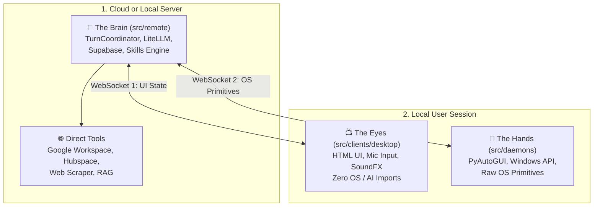
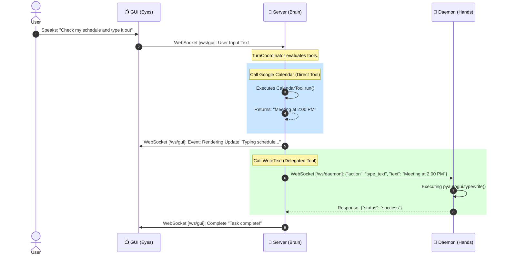

# 📋 Design Specification: 3-Tier Architecture (Brain, Hands, and Eyes)

## 1. Executive Summary

Currently, the Chad Assistant codebase suffers from heavy architectural coupling. The `main_gui.py` process (the frontend) imports and compiles heavy LLM orchestration libraries (`litellm`, `langgraph`) and system modules (`SystemFactory`) during startup, even when running in networked "Uplink" mode. This violation of the Single Responsibility Principle results in bloated memory footprints, slow UI boot times, and "drift bugs" caused by duplicate execution-loop configurations.

This specification defines a **3-Tier Distributed Architecture** to surgically isolate execution concerns into three decoupled, dedicated processes:

1.  **🧠 The Brain (Server)**: Logic, planning, ReAct loop, Memory DB, Cloud Tools.
2.  **👐 The Hands (OS Daemon)**: Invisible background Windows automation runner (PyAutoGUI, Windows API).
3.  **📺 The Eyes (GUI)**: Thin HTML display, status animations, microphone input, and sound effects.

---

## 2. Architectural Overview

### 💎 The Split Principles:
*   **No AI in the GUI**: `src/clients/` is strictly forbidden from importing `litellm`, `langgraph`, or `SystemFactory`.
*   **No UI in the Brain**: `src/remote/` does not import any window managers, displays, or audio hardware primitives.
*   **No OS in the Brain**: The Server process is OS-agnostic. It imports **zero** local computer manipulation libraries (`pyautogui`, `pygetwindow`).

---

## 3. Detailed Process Responsibilities

### 🧠 Tier 1: The Brain (Server Process)
*   **Process Location**: `src/remote/server.py`
*   **Primary Job**: Runs the universal ReAct execution loop and maintains state.
*   **Responsibilities**:
    *   Translates user input (text/voice) into plans via **TurnCoordinator**.
    *   Stores & retrieves persistent user memory and context via **Supabase**.
    *   Hosts the **Master Tool Registry**. 
    *   Directly executes **API-based Tools** (Google Workspace, Hubspace).
    *   Exposes two multiplexed WebSocket pipes: `/ws/gui` and `/ws/daemon`.
*   **Key Permitted Dependencies**: `litellm`, `langgraph`, `supabase`, `src/application/system_factory.py`.

### 👐 Tier 2: The Hands (OS Daemon Process)
*   **Process Location**: `src/daemons/hands.py`
*   **Primary Job**: Executes low-level Windows API commands on behalf of the Server.
*   **Responsibilities**:
    *   Connects to the Brain's `/ws/daemon` WebSocket endpoint as a persistent background service.
    *   Maintains a lookup table of **Raw OS Primitives** (e.g., `type_text`, `take_screenshot`, `open_app`, `set_volume`).
    *   Fires physical Windows automation commands and returns the result JSON back to the server.
    *   Operates headlessly and invisibly.
*   **Key Permitted Dependencies**: `pyautogui`, `pygetwindow`, `comtypes`, `pywin32`.

### 📺 Tier 3: The Eyes (GUI Process)
*   **Process Location**: `src/clients/desktop/app_controller.py`
*   **Primary Job**: Dumb display shell and voice visualizer.
*   **Responsibilities**:
    *   Loads the pywebview2 instance and renders the HTML5/React frontend.
    *   Listens to the local microphone and streams raw PCM chunks to the server.
    *   Triggers local sound effects and voice synthesizer streams.
    *   **Zero concept of Tools or AI**. It simply renders `{"type": "status", "message": "..."}` states sent by the server.
*   **Key Permitted Dependencies**: `pywebview`, `pyaudio`, `pvporcupine` (Wake Word).

---

## 4. Tool Execution & The "Primitive Delegate" Flow

Rather than splitting the Tool class files across multiple directories, all Tool definitions remain on **The Brain** to allow the LLM to inspect schemas. However, Windows-based tools are **hollowed out** to eliminate OS imports on the Server.

### Category A: Cloud-Direct Execution (Server-Side)
If the AI invokes a tool like `search_gmail`, the execution remains local to the server process:
1.  `GmailTool.run()` executes.
2.  Calls `googleapiclient` HTTPS REST request directly to the Cloud.
3.  Returns standard JSON result.

### Category B: Daemon-Delegated Execution (Networked OS Primitives)
If the AI invokes a tool like `type_text`, execution crosses the process boundary:
1.  `TypeTool.run(text="hello")` executes on the Server.
2.  Because it lacks physical OS access, it serializes the request:
    `{"action": "type_text", "args": {"text": "hello"}}`
3.  Pipes it across WebSocket `/ws/daemon` to the Hands daemon.
4.  **The Hands Daemon** executes `pyautogui.typewrite("hello")`.
5.  Returns `{"status": "success"}` to the Server.
6.  `TypeTool` returns standard JSON result.

---

## 5. Sequence Diagram: A Multi-Turn Flow

---

## 6. Phase 1 Action Plan

| Step | Task | Goal |
| :--- | :--- | :--- |
| **1. The Daemon** | Create `src/daemons/hands.py` | Extracate physical `pyautogui` execution into raw primitive command handlers. |
| **2. The Bridge** | Upgrade `src/remote/server.py` | Implement WebSocket `/ws/daemon` client tracking and generic primitive command dispatcher. |
| **3. The Tools** | Hollow out OS Tools | Modify `src/infrastructure/tools/` OS tools to use WebSocket dispatching instead of direct system imports. |
| **4. The GUI** | Surgical Strip of GUI | Modify `app_controller.py` to eliminate `SystemFactory` / `ChadAssistant` boot routines. Introduce `LimbAssistant` (Hardware/Display Only). |

---

## 7. Success Criteria
- ✅ `main_gui.py` process memory footprint reduced by ~50%.
- ✅ `main_gui.py` imports zero lines of `litellm`, `google.generativeai`, or `langgraph`.
- ✅ UI can crash and reload while the Hands daemon safely completes an active keystroke automation task.
- ✅ System boot speed under 1.0s for the Visual client.

---

## 8. Edge Cases, Security, & Mitigation (Peer Review Enhancements)

Based on design reviews, we have formalized several mitigation patterns for network-distributed local execution:

### 🛡️ A. Daemon Security & Authentication
*   **The Threat**: Unauthorized local or external processes connecting to `/ws/daemon` and executing arbitrary keyboard inputs.
*   **The Fix**: The `/ws/daemon` endpoint **enforces the existing `CHAD_SERVER_TOKEN` auth flow** during the WebSocket upgrade handshake.
*   **Restriction**: By default, the server listener restricts daemon socket binding exclusively to `127.0.0.1` unless `CHAD_CLOUD_DEPLOYMENT=true` is explicitly configured.

### ⚡ B. Latency & Overhead Mitigation (Network Loop)
*   **The Threat**: Repetitive tasks (e.g., multi-stage Playwright interactions or repeated screenshots) adding sequential network round-trip lag.
*   **The Fix**:
    *   **Batched Primitives**: The WebSocket protocol supports a `batch` command type, enabling the Server to push a sequence of multiple operations in a single payload.
    *   **Aggressive Timeouts**: Daemon requests feature strict, configurable timeouts (e.g., 2.5s max for standard OS events) to prevent hanging the LLM planning phase.

### ⏳ C. Startup Race Conditions & Fallbacks
*   **The Threat**: The ReAct Loop triggers an OS-level tool call before the standalone Hands Daemon has fully booted and established its socket connection.
*   **The Fix**:
    *   **Immediate Rejection**: If the `DaemonExecutorBridge` detects `connected = False`, it immediately throws a structured `DaemonOfflineError` instead of blocking.
    *   **LLM Feedback**: The error returns: `"OS automation is currently offline. Ensure the Windows Hands Daemon is running."` to the LLM. This prevents long UI hangs and instructs the AI to gracefully explain to the user that local control is inactive.
