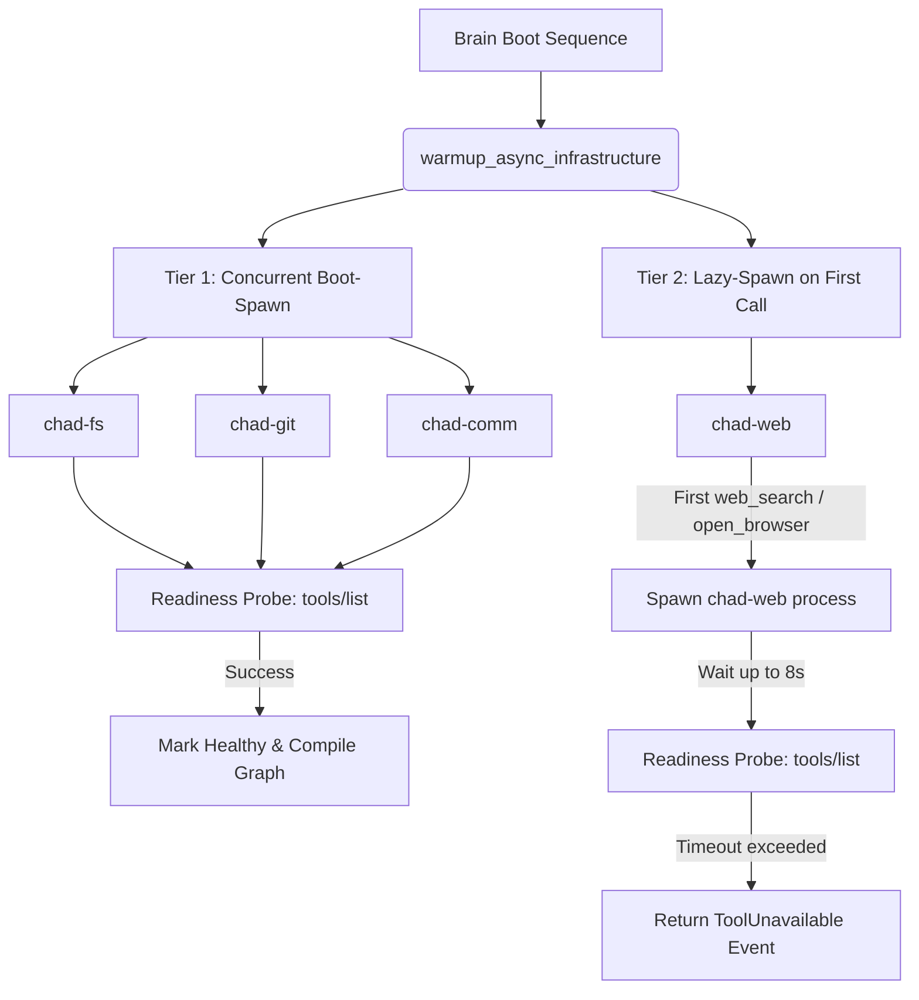
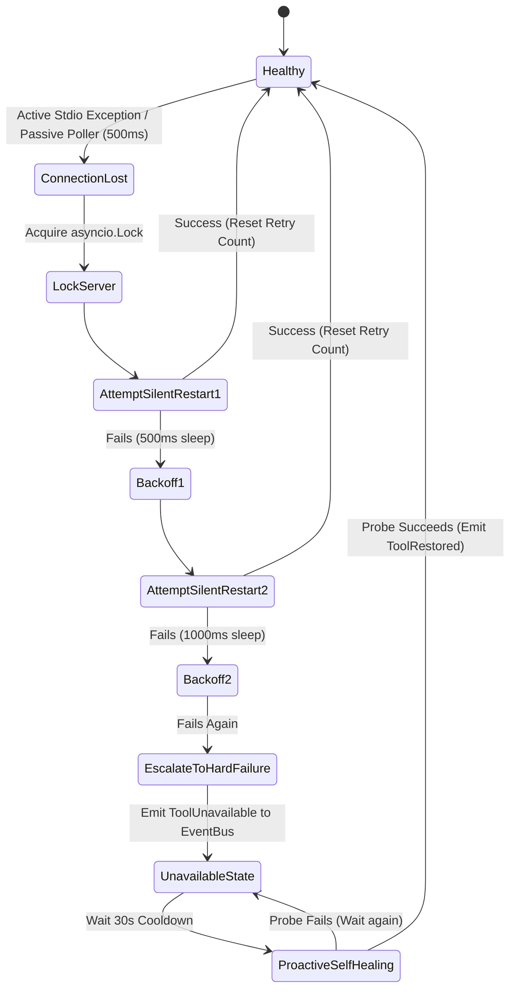
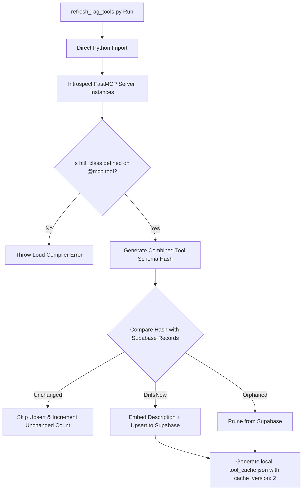

# MCP Tools Migration Design Specification

* **Date:** May 17, 2026
* **Status:** APPROVED
* **Target Version:** Chad v2.0 (MCP Architecture)
* **Author:** Antigravity (AI Coding Assistant)

---

## Executive Summary & Orientation Table

This document defines the formal architectural blueprint for converting Chad's bespoke Tool Registry system into a domain-segmented, isolated, and highly resilient Multi-Process Model Context Protocol (MCP) server cluster. By migrating stateless utility tools into dedicated subprocesses while retaining stateful orchestration primitives in-process (Option A: Hybrid Topology), Chad gains modular execution security, resilient process boundaries, and a scalable interface for human-in-the-loop (HITL) authorization.

| Section | Architectural Decision | Key Technical Constraints & Budgets |
| :--- | :--- | :--- |
| **1. Subprocess Lifecycle** | Approach 1 (Managed Stdio Subprocesses) | Tier 1 boot-spawn with concurrent `tools/list` readiness probes. Tier 2 lazy-spawn (`chad-web`) with an 8s timeout budget. Reverse teardown sequence. |
| **2. Restart Policy** | 2 Silent Retries + Proactive 30s Self-Healing | 500ms / 1000ms backoff. Passive returncode polling at 500ms intervals. Structured tool-name error payload. |
| **3. Interceptor Spec** | Global client-side middleware on `MultiServerMCPClient` | Inject `turn_id` in all events. Sanitized `args_summary` for UI logs. Centralized security output sanitization pass. |
| **4. RAG Sync** | Static python import introspection | Schema drift detection before database upsert. Decorator co-located `hitl_class` metadata. Cache versioning (`cache_version: 2`). |
| **5. HITL Gates** | Dynamic metadata-driven `NodeInterrupt` | Git read-operations (`diff`, `log`, `status`) auto-execute (`READ`). 5-minute approval timeout with UI countdown. |

---

## 1. Subprocess Lifecycle Contract

The parent Brain process will orchestrate all FastMCP server processes using `asyncio.create_subprocess_exec` to ensure completely non-blocking process launching, stdio piping, and standard error captures.



### 1.1 Spawn Scheduling & Readiness Probes
To minimize first-turn cold-start latency while maintaining runtime schema guarantees, servers are split into two launch tiers:
* **Tier 1: Concurrent Boot-Spawn (`chad-fs`, `chad-git`, `chad-comm`)**
  * Initiated concurrently during `SystemFactory.warmup_async_infrastructure`.
  * **The Readiness Probe:** To prevent the Brain from compiling the LangGraph agent against half-initialized tool structures, the parent process dispatches an asynchronous `tools/list` JSON-RPC request to each subprocess immediately on startup. The server is marked `READY` only after a successful response is parsed.
* **Tier 2: Lazy-Spawn (`chad-web`)**
  * Spawns lazily on the first invocation of a browser, search, or scraping tool.
  * **The Startup Budget:** The lazy spawn is granted a maximum budget of **8.0 seconds** to boot and respond to its initial `tools/list` readiness probe. If this budget is exceeded, the calling tool node immediately returns a `ToolUnavailable` payload rather than stalling the ReAct loop indefinitely.

### 1.2 Execution Context & Environment
* Subprocesses execute using the active virtual environment python interpreter (`sys.executable`) to avoid version or dependency collisions.
* **Diagnostic Console Routing:** When `CHAD_MCP_DEBUG=true` is set in the environment, the `stderr` streams of the subprocesses are piped directly to the parent process's console stream. In standard execution, they are silently intercepted and routed to `setup_logger("MCPServer.<name>")`.

### 1.3 Teardown Sequence (Reverse Dependency Order)
To ensure that in-flight database edits, filesystem syncs, or communication drafts complete their cleanups cleanly before standard filesystem capabilities are severed, teardown executes in reverse dependency order:
$$\text{chad-web} \longrightarrow \text{chad-git} \longrightarrow \text{chad-fs} \longrightarrow \text{chad-comm}$$
On shutdown, the parent process iterates through this sequence, executing:
1. Dispatch `SIGINT` (graceful termination request).
2. Wait up to a **2.0-second graceful window** per process.
3. Fallback to `terminate()` (hard SIGKILL) if the process is unresponsive.

---

## 2. Restart Policy & Resilience

If a single FastMCP subprocess crashes or hangs, the system must recover transparently without halting the LangGraph execution flow.



### 2.1 Double-Seam Failure Detection
* **Active Seam:** Catches `BrokenPipeError`, `ConnectionResetError`, or `asyncio.TimeoutError` immediately during an ongoing JSON-RPC tool transaction.
* **Passive Seam:** A background supervisor thread checks `process.returncode` for all active processes on a strict **500ms polling interval**.

### 2.2 Silent Recovery Loop
When a failure is detected, the `MCPRegistry` locks that server node via an `asyncio.Lock` to block concurrent incoming calls, then triggers a silent recovery sequence:
* **Silent Retry Budget:** Maximum of **2 silent restart attempts**.
* **Sequential Backoff:**
  * **Attempt 1:** 500ms delay before spawn (allows standard file descriptors to clear).
  * **Attempt 2:** 1000ms delay before spawn.
* **UI Behavior:** To prevent UI flashing, the `EventBus` remains completely silent during these retries. The tool execution simply appears to be "thinking" slightly longer.
* **Debugging Mode:** If `CHAD_MCP_DEBUG=true`, the detailed traceback of the crash and the exact retry timings are printed directly to the developer console.

### 2.3 Escalation (Hard Failure) & Proactive Self-Healing
If both silent retries are exhausted without a successful readiness probe, the server enters the `UNAVAILABLE` state:
1. **Svelte UI Alert:** A `ToolUnavailable(server_name, reason)` event is dispatched onto the `EventBus` so the Svelte UI can display a warning banner.
2. **LangGraph Graceful Recovery Payload:** The calling tool node returns a standardized instruction string rather than throwing a python exception:
   `⚠️ ERROR: [{tool_name}] failed. Server '{server_name}' is offline after 2 restart attempts. Pivot strategy: consider notifying the user or attempting the task via an alternative tool.`
3. **Proactive Self-Healing Loop:** The `MCPRegistry` schedules a background task that executes a lightweight probe on the unavailable server **every 30 seconds**. Once the probe succeeds, the server returns to `HEALTHY` and broadcasts a `ToolRestored(server_name)` event to clear the UI warning.

---

## 3. Telemetry & Tele-Security Interceptor Spec

A global middleware interceptor on the parent's `MultiServerMCPClient` catches all tool requests and completions, routing trace telemetry to LangSmith and event states to the Svelte UI.

```python
class ToolStarted(Event):
    name: str          # e.g., 'execute_python'
    args: Dict[str, Any]          # Full args (sent to LangSmith only)
    args_summary: str             # Truncated, redacted string (sent to Svelte UI)
    server_name: str   # e.g., 'chad-fs'
    turn_id: str       # Correlates back to the current LangGraph turn
    timestamp: float   # Epoch time in seconds

class ToolCompleted(Event):
    name: str
    result: Any        # Sanitized, injection-free output payload
    server_name: str
    turn_id: str
    elapsed_ms: float  # Performance benchmark
    timestamp: float

class ToolFailed(Event):
    name: str
    error: str         # Standardized traceback or timeout error
    server_name: str
    turn_id: str
    elapsed_ms: float
    timestamp: float
```

### 3.1 Turn Correlation & Args Sanitization
* **Turn Correlation:** Injecting `turn_id` into all three event schemas ensures the Svelte UI can instantly correlate tool lifecycle transitions back to the specific execution turn that triggered them, preventing visual bugs when handling overlapping parallel subagent calls.
* **Parameters Sanitization (`args_summary`):** The interceptor generates a maximum **100-character truncation** of the inputs. Any keys indicating sensitive or bloated data (`code`, `body`, `password`, `token`, `api_key`) are dynamically replaced with `[redacted]`. The Svelte UI log displays this safe summary string, while LangSmith receives the full payload.

### 3.2 Security Output Sanitization Pass
To protect against prompt injection vectors (e.g., hidden instructions embedded in scraped website HTML or files), the interceptor executes a centralized **sanitization pass** on all `ToolCompleted.result` payloads before they are merged into the LangGraph state:
* Strips known markdown and raw instruction injection patterns.
* Appends `[TOOL_DATA]` wrappers to mark external content boundaries clearly.
* Prevents the necessity of scattering security filtering logic across 60+ independent child tool implementations.

---

## 4. RAG Sync & Introspection Spec

The developer utility script `src/scripts/refresh_rag_tools.py` will be refactored to parse the decorators on the 4 server files to update Supabase.



### 4.1 Schema Drift Detection
To protect database write quotas and avoid unnecessary vector generation passes, the sync script compares schema hashes:
$$\text{Schema Hash} = \text{hash}(\text{name} + \text{description} + \text{input\_schema} + \text{hitl\_class})$$
* **New/Updated Tools:** Embedded and upserted only if the local hash drifts from the database record.
* **Deleted Tools:** Orphaned database rows whose tool names are no longer present in the local codebase are pruned automatically.
* **Sync Log Console Output:** Prints a detailed diff summary:
  ```text
  [refresh_rag_tools] Schema changes detected:
    UPDATED: read_file (description changed)
    NEW:     write_file_atomic (new tool)
    REMOVED: legacy_write (no longer in registry)
    UNCHANGED: 61 tools (skipped)
  ```

### 4.2 Decorator-Enforced HITL Class (Single Source of Truth)
To eliminate double-maintenance bugs, the human-in-the-loop setting is co-located directly within the tool code via metadata attributes on the FastMCP tool decorator:
```python
@mcp.tool(hitl_class="WRITE")
async def git_push_files(path: str, message: str) -> str:
    """Push committed files to remote."""
    ...
```
* If a developer adds a new tool without declaring an explicit `hitl_class="READ"` or `hitl_class="WRITE"`, the sync script immediately throws a loud, blocker exception.

### 4.3 Versioned Local Offline Cache
The generated local backup cache file (`data/tool_cache.json`) incorporates a top-level schema validation key:
```json
{
  "cache_version": 2,
  "generated_at": "2026-05-17T14:23:00Z",
  "tools": [...]
}
```
If the parser loads a cache file containing a legacy version code, the file is treated as corrupt/stale, and Chad falls back to querying the primary Supabase tables to prevent execution anomalies.

---

## 5. HITL Boundary Enforcement

Human approval boundaries are enforced at the execution boundary rather than statically wired in the LangGraph compiler, avoiding configuration drift.

### 5.1 Dynamic NodeInterrupt Gates
Rather than defining a hardcoded static list of tools in the graph compilation statement, our unified tool execution node dynamically inspects the `hitl_class` metadata of the selected tool:
* **READ-class Tools (Auto-Execute):** Runs instantly without user intervention.
* **WRITE-class Tools (Gated Execution):** The node raises a LangGraph `NodeInterrupt`, freezing graph execution, saving a checkpointer checkpoint to SQLite, and dispatching a `TurnSuspended` event.

### 5.2 Side-Effect Git and File Split
To avoid approval fatigue while maintaining absolute integrity, we implement fine-grained permissions based on state side effects:
* **`chad-fs` Permissions:**
  * `READ`: `read_file`, `list_directory` (auto-execute).
  * `WRITE`: `write_file`, `edit_file` (gated).
* **`chad-git` Permissions:**
  * `READ`: `git_status`, `git_diff`, `git_log` (auto-execute).
  * `WRITE`: `git_commit`, `git_push_files`, `git_checkout`, `git_reset` (gated).

### 5.3 5-Minute Approval Timeout
To prevent resource leaks, ghost checkpoint allocations, or process locks when a user walks away:
* The Brain runner starts an async **300-second (5 minutes)** countdown timer immediately upon turn suspension.
* The Svelte UI reads this countdown and displays a visible deadline bar on the interactive approval card.
* **Auto-Cancellation:** If no `turn_resume` payload is received via the WebSocket connection before the 300s budget is exhausted, the Brain executes an automatic, safe cancellation, resuming the graph with a synthetic failure response:
  `⚠️ TIMEOUT: No response received for [{tool_name}] within 5 minutes. Operation cancelled automatically. Please re-issue your request to try again.`
