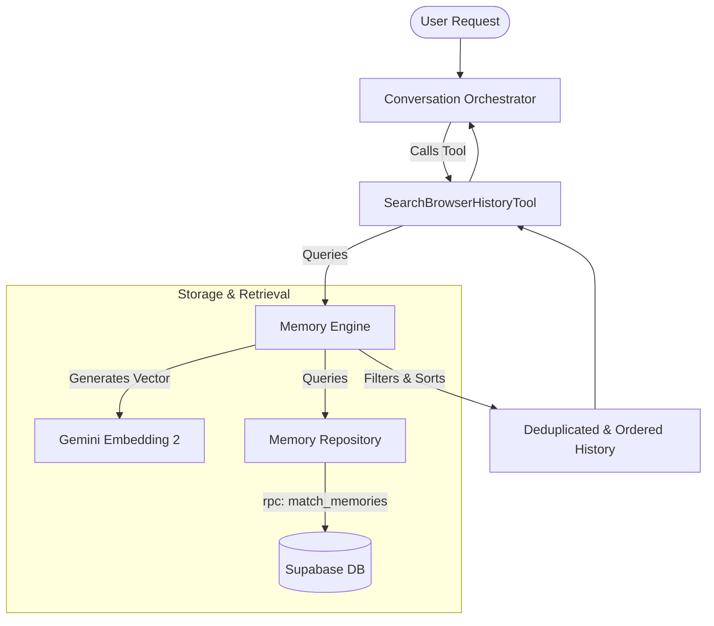

# Design Spec: Dedicated Browser & YouTube History Search

This design specification details the architecture for adding a specialized, high-precision search capability for synced browser/Chrome history (category `personal_index`) alongside fixing the YouTube history link display issue.

---

## 1. Objectives & Success Criteria
- **Link Integrity**: All ingested YouTube video history items must contain the exact, clickable video URL in their content string, resolving the issue where Chad is given only `"youtube.com"`.
- **Durable History Search**: Chad must have a dedicated, low-latency tool `search_browser_history` to query browser history.
- **Adaptive Sorting**: The search tool must support both `sort_by="relevance"` (semantic cosine similarity) and `sort_by="recency"` (chronological freshness) to answer time-sensitive historical lookups.
- **Isolate Identity vs History**: Browser history search must target only `category="personal_index"`, protecting the core user preferences/identity memories from pollution.

---

## 2. System Architecture

---

## 3. Detailed Component Designs

### A. The Tool Layer: `SearchBrowserHistoryTool`
- **File Location**: `src/tools/web/search_browser_history.py`
- **Tool Name**: `search_browser_history`
- **Category**: `web`
- **Schema Definition**:
  - `query` (string, required): Semantic term or topic to search.
  - `limit` (integer, optional, default: 10): Maximum items to return.
  - `sort_by` (string, optional, enum: `["relevance", "recency"]`, default: `"relevance"`).

### B. The Backend Service Layer: `MemoryEngine` Extensions
- **File Location**: `src/core/intelligence/memory_engine.py`
- **New Methods**:
  - `search_browser_history(self, query: str, limit: int = 10, sort_by: str = "relevance") -> List[Dict[str, Any]]`
  - `_map_and_dedup_history(self, items: List[Dict[str, Any]], limit: int) -> List[Dict[str, Any]]`

#### Ingestor Updates: `chrome.py`
- **File Location**: `src/core/intelligence/ingestion/chrome.py`
- **Changes**:
  - Ingested YouTube videos format: `"Watched YouTube Video: '{title}' ({url})"`
  - Ingested general web pages format: `"Visited Web Page: '{title}' ({url})"`

---

## 4. Testing & Verification Plan

### Unit Tests
- Create `tests/unit/test_search_browser_history.py` verifying:
  - Tool execution maps parameters correctly.
  - `MemoryEngine.search_browser_history` handles semantic fallback when embeddings fail.
  - Recency sorting orders matching items chronologically regardless of vector similarity score.
  - Deduplication prevents repeating identical titles/URLs.

### Integration Tests
- Verify the SQLite/Supabase RAG query pipelines return the correct `personal_index` objects with correct schema fields.
