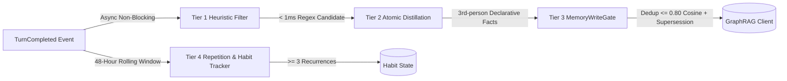

# Autonomous Companion & Continuous Learning Architecture

## Overview
Chad features an autonomous companion architecture designed around organic, human-like interaction and 2026-standard continuous learning. It moves beyond passive batch crons into real-time habit extraction, proactive topic curation, and strict anti-annoyance silence guarantees.

---

## 1. Real-Time Proactive Memory & Habit Extraction

### Problem Solved
Historically, memory retrieval was functional, but Chad only ingested new knowledge during 24-hour batch reflection crons or upon explicit commands. Spoken preferences, family/friend mentions, and conversational habits were not absorbed immediately into the knowledge graph.

### Architecture (2026 Mem0 / GraphRAG Pattern)
Implemented in `src/core/autonomy/proactive_memory.py` and hooked via `src/core/intelligence/reflection_trigger.py`:

- **Zero Latency Impact:** Subscribes to `TurnCompleteEvent` via `asyncio.create_task`—completely decoupled from the critical response loop (0ms user wait).
- **Module-Level WeakRef Handlers:** `EventBus` stores weak references (`weakref.ref`). Handlers must be module-level functions or bound to long-lived singleton instances to prevent garbage collection.
- **Atomic Fact Distillation:** Isolates statements into standalone 3rd-person declarative facts (e.g., *"Matthew prefers concise responses over long paragraphs"*).
- **Deduplication & Conflict Resolution:** Gated through `MemoryWriteGate` with a 0.80 cosine similarity floor to supersede old statements rather than appending duplicates.
- **Habit Tracking:** Analyzes normalized assertions across a rolling 48-hour window in `system_state`. When an activity, tool, or interest is observed 3+ times, it is surfaced as an established habit.

---

## 2. Organic Curiosity Scavenger & Impulse Pacing

### Problem Solved
Autonomous messaging should feel like a real friend reaching out spontaneously—not a rigid cron firing at predictable times with cheesy metaphors or robotic status reports.

### Components
- **Curiosity Scavenger (`src/core/autonomy/curiosity_service.py`):**
  - Maintains a local verified stash of trending content (GitHub repositories, YouTube shorts, tech tools, anime updates).
  - Paced on a 12-hour cadence or triggered when the verified stash drops below 2 items.
  - Dynamically controlled via `daemon_enabled("scavenger", default=True)`.
- **Impulse Engine (`src/core/autonomy/impulse_engine.py`):**
  - **Quiet Hours:** Hard silence enforced between 23:30 and 08:30 local time.
  - **Cooldowns:** Minimum 3.5-hour spacing between spontaneous messages; maximum 2 spontaneous outreaches per day.
  - **Calendar Awareness:** Skips outreach during classes, meetings, or busy events.

### Style & Anti-Regression Rules
Defined in `prompts/persona/heartbeat.md` and `config/persona/heartbeat.md`:
- **Zero Forced Metaphors:** Real humans speak directly. Never use cheesy analogies (*"this is the Ferrari of code"*).
- **Zero Fake Telepathy:** Never guess user posture, physical status, or actions unless verifiable from hard evidence (recent git commits, calendar entries).
- **No Bot Greetings:** Never open with *"Hey Matthew!"* or repetitive greeting formulas.
- **Lowercase & Casual:** Punchy, 1–3 lines max, fitting natural iMessage/SMS rhythm.

---

## 3. Webhook Silence & Anti-Leak Safeguards

### Problem Solved
Gmail Pub/Sub webhooks previously injected raw technical identifiers (`History ID: 4432773`) and commanded the model to *"speak to the user naturally about your findings"*, which caused Chad to text the user about empty history sweeps or pharmacy marketing notices.

### Implementation (`src/remote/webhooks/gmail_handler.py`)
- **Diagnostic Masking:** History IDs and internal event numbers are stripped from user-facing prompts.
- **Critical Silence Rule:** If an event has no new emails, or if the email is automated marketing, promo, spam, order updates, or routine pharmacy reminders that do not require immediate human action:
  - The model **MUST return exactly `HEARTBEAT_OK`**.
  - `TelegramResponseRouter` suppresses all `HEARTBEAT_OK` and silence variations (`"inbox is clear"`, `"nothing urgent"`), preventing unwanted phone notifications.
- **Urgent Filtering:** Chad only texts the phone if the incoming email is a direct, urgent message from a real person (professors, family, collaborators) that requires attention.

---

## 4. Telegram & GUI Channel Decoupling

- **Turn Isolation (`src/remote/ui_state_syncer.py`, `src/remote/gui_limb.py`):**
  - Inbound Telegram messages route through `session_key` (`main:<chat_id>:telegram:<chat_id>`).
  - Desktop Limb UI ignores Telegram turn buckets, eliminating phantom messages appearing in the GUI stream.
- **Unrestricted Pocket Remote:**
  - Removed suppression logic that silenced Telegram when a desktop GUI limb was connected. Matthew can leave his PC running at home and still receive alerts and chat with Chad on mobile.
