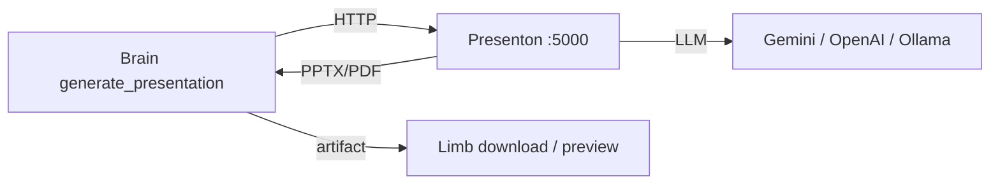

# Presenton — AI presentation sidecar (issue #350)

Part of Chad's **visual output** stack — see [VISUAL_OUTPUT.md](VISUAL_OUTPUT.md) for diagrams, PDFs, Marp, and roadmap.

[Presenton](https://presenton.ai/) is an Apache 2.0 presentation generator Chad can call to produce branded PPTX/PDF decks from a topic or document brief. It runs as an **optional** Docker sidecar — nothing in core Chad depends on it.

## When to use

| User ask | Chad path |
|----------|-----------|
| Polished AI deck from topic/outline | `load_skill('presenton')` → `generate_presentation` |
| Quick markdown slides | `load_skill('marp')` → `render_marp` |
| Edit existing `.pptx` | `load_skill('pptx')` |

## Setup

1. Open **Settings → Services → Presenton**, set the URL and model, then click
   **Connect / set up Presenton**.
2. Chad first checks the configured authenticated API. If it is already connected,
   Docker and `docker/presenton/.env` are left untouched.
3. For an unreachable external URL, Chad reports the connection failure and never starts
   local Docker. For the default local URL, Chad starts its compose service. An existing
   `.env` is preserved; Chad only creates one when none exists.
4. **Optional secrets** (`config/secrets.yaml`):
   ```yaml
   PRESENTON_AUTH_USERNAME: chad
   PRESENTON_AUTH_PASSWORD: your-admin-password
   PRESENTON_API_KEY: sk-presenton-xxxxx   # cloud async only
   ```

Presenton **v8+ requires admin login** for all `/api/v1/ppt/*` routes. For a fresh local
setup Chad creates credentials and sends HTTP Basic auth from `generate_presentation`.
Existing environments must already contain `AUTH_USERNAME` and `AUTH_PASSWORD`; Chad will
report the missing fields instead of overwriting the file.

Verify with `.\scripts\setup\verify_chad_services.ps1` or `GET /api/services/health`.

## Tool: `generate_presentation`

| Parameter | Default | Notes |
|-----------|---------|-------|
| `content` | — | Topic, outline, or source text (required) |
| `n_slides` | 8 | 3–30 |
| `template` | `general` | `general`, `modern`, `standard`, `swift`, `report`, `pitch-deck`, … |
| `export_as` | `pptx` | `pdf` |
| `language` | `English` | |
| `theme` | — | Optional Presenton theme id |
| `title` | `presentation` | Artifact filename stem |

Returns a downloadable artifact (`download_token`, `auto_preview`) plus optional `edit_url` for Presenton's web editor.

## API modes

| `visual.presenton_use_async` | Behavior |
|------------------------------|----------|
| `false` (default) | Sync v1 — `POST /api/v1/ppt/presentation/generate` (self-host) |
| `true` | Async v3 — submit + poll `/api/v3/async-task/status/{id}` (cloud / long jobs) |

Tune timeouts: `visual.presenton_generation_timeout_seconds` (default 300), `visual.presenton_poll_interval_seconds` (default 5).

## Architecture



Presenton is a **Service** (infrastructure), not an MCP add-on. See `docs/guides/SERVICES_AND_MCPS.md`.

## Related files

- Tool: `src/tools/visual/generate_presentation.py`
- Skill: `src/skills/presenton/SKILL.md`
- Docker: `docker/presenton/`, `docker/chad-services.yml` (profile `presenton`)
- Registry bundle: `visual_presenton` in `src/infrastructure/tools/registry.py`
