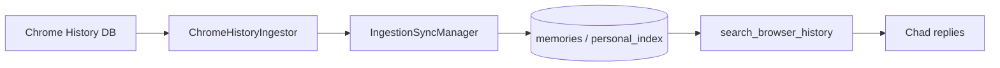

# Browser & Activity History Setup

Chad can search your recent Chrome browsing history (and, when configured, Gmail and
Google Drive activity) so you can ask things like *"that article about retro gaming I
read last week"* or *"did I visit the AutoTrader listing?"*

This is **not** browser automation (`browser_agent` / Playwright). History search reads
your existing Chrome profile's SQLite database and indexes visits into the **Activity**
memory section (`personal_index`). See [BROWSER_AUTOMATION.md](../features/BROWSER_AUTOMATION.md)
for live DOM control.

---

## What you get

| Capability | Tool | Where data lives |
|---|---|---|
| Search indexed history | `search_browser_history` | Local sqlite `memories`, `category=personal_index` (never mirrored to Supabase) |
| Manual refresh | `refresh_browser_history` | Same — triggers `ChromeHistoryIngestor` |
| Background sync | `daemons.ingestion_sync` (default **off** — opt-in) | Every 60 min once enabled |
| Enable/disable | Settings → **Capabilities** | Reads your Chrome history only after you turn it on |
| UI inspection | Settings → Memory → **Activity** | Same store |

**Privacy note:** this capability is off by default on a fresh install/clone. Nothing
reads your Chrome history until you explicitly enable it in Settings → Capabilities (or
call `refresh_browser_history` yourself) — there's no silent background read of personal
browsing data before you opt in.

Indexed items include visited URLs, page titles, and YouTube videos (with exact video URLs).

---

## Requirements

| Requirement | Notes |
|---|---|
| **Windows** | Chrome history ingestor reads `%LOCALAPPDATA%\Google\Chrome\User Data\Default\History` |
| **Google Chrome** | Must be your daily browser; Edge/Firefox are not supported yet |
| **Chrome in use** | Safe — Chad copies the DB to a temp file to avoid lock errors |
| **Memory backend** | Works in **local-only mode** (#416). Chrome/Gmail/filesystem Activity rows stay on sqlite forever (never mirrored — PRs #621/#622) |
| **Embeddings** | Local `nomic-embed-text-v2-moe` via `sentence-transformers` (no extra setup) |

Gmail and Google Drive activity use the same Activity store but need the
[Gmail connector](CONNECTORS.md) (and Drive MCP OAuth) configured first.

---

## First-time setup (newcomer path)

### 1. Bootstrap config (if you haven't already)

```powershell
.\scripts\setup\bootstrap_config.ps1
```

### 2. Enable the capability

Browser history sync is **opt-in** — it defaults off so a fresh install never reads your
Chrome history without you asking for it. Turn it on in **Settings → Capabilities →
Browser history sync**; the toggle explains exactly what gets read before you confirm.

Once enabled, it syncs on its own timer (interval configurable in Settings →
Automations), or trigger a one-time sync after Chad is running by asking in chat:

> "Refresh my browser history"

Chad calls `refresh_browser_history`, which ingests the last 24 hours of Chrome visits
on first run (no prior sync watermark).

### 3. Verify it worked

**In the GUI:** Settings → Memory → **Activity** — you should see indexed visits after
sync completes (may take a minute on first embed pass).

**In chat:** ask something only answerable from your history, e.g. *"What GitHub repos
did I look at today?"*

**Maintainer script (optional):**

```powershell
$env:PYTHONPATH="."
.\.venv\Scripts\python.exe scripts\verify_real_chrome_sync.py
```

---

## How sync works



- **Incremental:** sync watermarks are stored in `system_state` (`personal_search_sync_states`).
- **Deduplication:** content hashes prevent re-embedding the same visit.
- **Retention:** Chrome entries older than 30 days are expired automatically.
- **Rate limits:** if embedding fails 3 times in a row (API quota), the cycle aborts early
  and resumes on the next scheduled run.

Toggle background sync from Settings → Capabilities (on/off) and Settings → Automations
(interval), or directly in `config/config.yaml`:

```yaml
daemons:
  ingestion_sync: false  # opt-in
  ingestion_sync_interval_minutes: 60
```

Leave it off and rely on manual `refresh_browser_history` only if you'd rather not run a
background timer at all.

---

## Local-only mode notes

With no Supabase configured, Activity rows are stored in `data/local_chad.db` alongside
other memories. Embeddings are computed locally regardless of backend. Sync watermarks
(`StateRepository` / `system_state`) are registered with `LocalPostgrestShim` and persist
in the same local database, so incremental sync survives restarts in pure local mode too.

---

## Troubleshooting

| Symptom | Likely cause | Fix |
|---|---|---|
| Activity section empty | Capability not enabled yet, or Chrome not used yet | Enable in Settings → Capabilities; browse a few sites; run `refresh_browser_history` |
| "Chrome history file not found" | Chrome not installed or non-default profile | Install Chrome or set a custom path (advanced — `ChromeHistoryIngestor(custom_history_path=...)`) |
| Sync adds 0 items | All recent visits already indexed | Normal after first successful sync |
| Search returns nothing | No matching indexed content | Widen query; check Activity section has rows |
| Gmail/Drive not in Activity | Connectors not configured | See [CONNECTORS.md](CONNECTORS.md) |
| Drive “where is that file?” weak | Catalog not synced / storage not local | Run `run_drive_catalog_sync.py`; check `drive_catalog.storage: local` |
| Gmail history thin | Capped lookback / never cold-reset | `run_gmail_ingest_sync.py --reset-watermark` with sane `gmail_lookback_days` (default 90) |

---

## Google Drive catalog (location index)

Separate from Activity Drive “modified file” rows. The catalog stores **name + folder path +
file id** so Chad can answer “where’s the wedding roadmap?” without LLM tool hops.

| Piece | Detail |
|---|---|
| Config | `drive_catalog.*` in `config.yaml` (`storage: local`, `skip_videos`, `max_files: 0` = uncapped) |
| Injector | `DOCUMENT CONTEXT (DRIVE)` with `id=…` for `google_drive_read_file` |
| One-shot | `scripts/maintenance/run_drive_catalog_sync.py` |
| Safety | Reconcile skips truncated listings; refuses empty keep-set / >25% mass delete |

Body text is **not** indexed — open the file on demand after a catalog hit.

---

## Gmail ingest (Activity)

Indexes **From / To / Subject + short snippet** (not full body). Default query keeps
**inbox + sent** (threads you start or reply to) and drops Gmail `promotions` /
`social` / `forums` plus common `noreply` senders.

| Config | Default | Notes |
|---|---|---|
| `memory.gmail_lookback_days` | `1100` (~3y) | `0` = no date filter |
| `memory.gmail_max_results` | `8000` | `0` = paginate until done |
| `memory.gmail_include_sent` | `true` | Outbound / initiated threads |
| `memory.gmail_exclude_categories` | promotions, social, forums | Marketing noise |
| `memory.gmail_exclude_noreply` | `true` | Automation senders |
| `memory.gmail_extra_query` | `""` | Extra Gmail operators if needed |

```powershell
$env:PYTHONPATH="."
$env:CHAD_HOME="<main checkout with Google token>"
.\.venv\Scripts\python.exe scripts\maintenance\run_gmail_ingest_sync.py
# Cold lookback (does not delete existing rows — hash dedupe):
.\.venv\Scripts\python.exe scripts\maintenance\run_gmail_ingest_sync.py --reset-watermark
```

Embeddings (~120/s short lines on CPU) are cheap; Gmail `messages.get` is the wall-clock
bottleneck on large cold syncs.

---

## Related docs

- [COLD_START.md](COLD_START.md) — full clone-to-running path
- [CONNECTORS.md](CONNECTORS.md) — Gmail / Google Drive for extended Activity sources
- [LOCAL_FIRST.md](LOCAL_FIRST.md) — sqlite primary, Supabase optional mirror
- [MEMORY_AND_CONTEXT.md](../architecture/MEMORY_AND_CONTEXT.md) — graph vs Activity vs Drive catalog
- [PRIVATE_DATA.md](../guides/PRIVATE_DATA.md) — what's stored locally vs cloud
