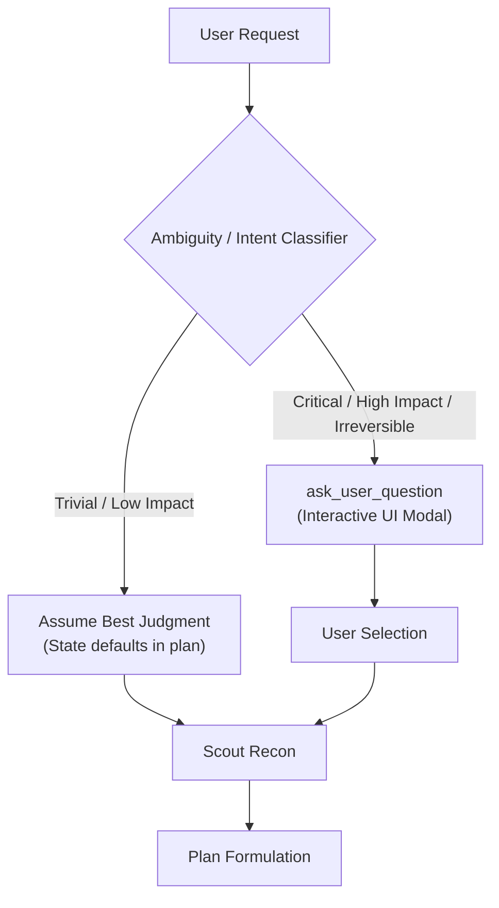
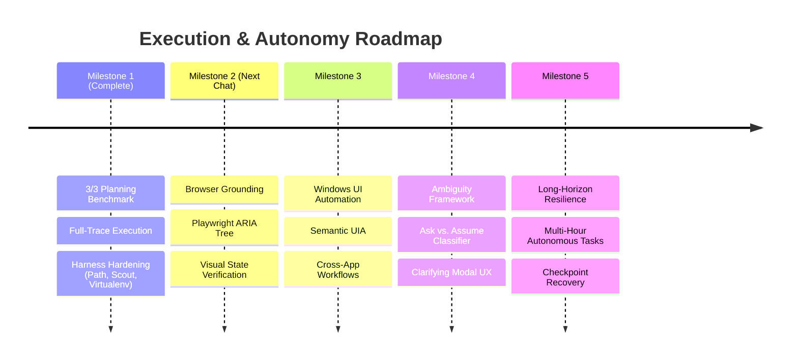

# Strategic Roadmap: Planning, Ambiguity, and Long-Horizon Autonomy

## 1. Executive Summary & Baseline

On **October 16, 2026**, Chad's planning and execution architecture reached a major milestone: **100% end-to-end completion across three complex zero-ambiguity workflows** using local model `prism-ml/bonsai-27b` (with `qwen2.5-3b-instruct` for Scout reconnaissance) on the isolated Dev Brain.

### Proven Capabilities
- **Two-Phase Autonomy**: Fast reconnaissance (Scout) -> Structured Plan Formulation (Planner) -> Approval Pause -> Multi-round Execution (Supervisor).
- **Tool Breadth**: Financial integrations (balances, transactions, Matplotlib charts), Google Workspace (Gmail drafts, Contacts), filesystem audits (pytest execution, markdown deliverables), and parallel web research (DuckDuckGo/Tavily synthesis).
- **Harness Robustness**: Real-time narration interruption (`NarrationWithoutActionGuard`), token runaway watchdog caps (~3000 tokens), and nested path creation.

This roadmap outlines the next development cycle to scale from clean, zero-ambiguity tasks to **ambiguous, long-horizon workflows**, culminating in **robust browser and computer use**.

---

## 2. Pillar 1: Strengthening Planning

While the core planner now formulates viable plans without infinite loops, scaling to open-ended tasks requires four architectural upgrades:

### A. Context-Aware Tool Selection on Planning Turns
- **Current Behavior**: Hybrid RAG (60 candidates) -> 9B LLM Selector picks ~2–5 tools based strictly on the user prompt.
- **Improvement**: 
  - Give the 9B selector visibility into **Scout gather results** before selecting execution tools, allowing it to bind specialized tools discovered during reconnaissance.
  - Implement dynamic category bundling so that if a domain is detected (e.g. `canvas`, `browser`, `finance`), the full domain toolset is available to both the planner and supervisor.

### B. Dynamic Step Budgets & Granularity Control
- **Problem**: Plans occasionally generate redundant steps (e.g. separating "synthesize into table" from "write file") or monolithic steps that time out.
- **Improvement**:
  - Introduce explicit step schemas: `action_step` (requires tools), `synthesis_step` (text/file output), and `verification_step` (check deliverable).
  - Enforce a max of 3–5 atomic steps per plan. Complex sub-goals should spawn sub-plans rather than bloated root plans.

---

## 3. Pillar 2: Strengthening Ambiguity Handling

In this benchmark, ambiguity was deliberately constrained to 0 to measure raw execution capability. Real user requests, however, are inherently underspecified.

### A. Intent & Ambiguity Classifier
- **Principle**: *Never ask trivial questions; never assume irreversible actions.*
- **Classification Taxonomy**:
  1. **Low Ambiguity / Actionable**: Proceed directly with sensible defaults. State assumptions in the proposed plan.
  2. **High Ambiguity / Non-Destructive**: Proceed with Scout reconnaissance first. Use findings to narrow options before asking the user.
  3. **High Ambiguity / Irreversible**: Trigger `ask_user_question` modal immediately before any execution begins (e.g. deleting files, sending live communications, making financial transfers).

### B. Compliance Guard for Questions
- Add an automated prompt/nudge guard to catch models asking conversational open-ended questions in chat (e.g. *"Would you like me to do X or Y?"*) instead of using the structured `ask_user_question` tool.

---

## 4. Pillar 3: Long-Horizon Task Execution

Autonomous tasks extending across 10–50 turns require state durability and recovery mechanisms that do not reset progress.

### A. Persistent Step Checkpointing & Sub-Goal Durability
- If a turn fails or times out, the supervisor must resume from the **last completed step**, retaining intermediate artifact paths in state.
- Prevent replanning from wiping completed step progress (already partially addressed in `_collapse_repeated_failures` and `fail_step`).

### B. Step-Level Verification Gates
- Before calling `complete_step`, require verifiable evidence of the deliverable (e.g. checking `file.exists()`, verifying HTTP 200, confirming draft ID in mailbox).
- If the deliverable is missing, prevent `complete_step` and inject a concrete failure context for immediate repair.

---

## 5. Next Horizon: Strengthening Browser & Computer Use

The immediate next priority is upgrading Chad's interactive system and web capabilities:

### A. Browser Agent (`browser_agent`) Hardening
- **DOM Element Grounding**: Transition from brittle CSS selectors to semantic ARIA snapshot trees (Playwright accessibility tree) for robust element identification.
- **Visual Verification Loop**: Take viewport snapshots after actions (click, type, navigate) to verify state transition before emitting next action.
- **Session & Cookie Persistence**: Ensure logged-in sessions (Gmail, Canvas, portals) are reliably maintained in dedicated browser profiles.

### B. Computer Use & Desktop Automation (`ui_automation_agent`)
- **Semantic UI MCP Integration**: Solidify the `windows-semantic-ui` MCP server for native Windows application control (Notepad, File Explorer, settings).
- **Coordinate-Free Interaction**: Prioritize accessibility object models (UIA / UI Automation) over raw pixel coordinates (`pyautogui`) for DPI and resolution resilience.
- **Safety Locks & Intervention**: Maintain human-in-the-loop override tokens for OS-level file deletion, credential entry, or software installation.

---

## 6. Implementation Milestones

