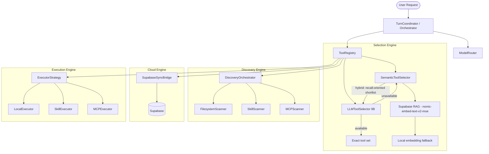

# 🛠️ Modular Tool Registry & Exposure System

This directory contains the infrastructure for **Tool Discovery, Selection, and Execution**. It is designed to be highly modular, replacing the legacy monolithic "UnifiedRegistry" with a decentralized, specialized engine.

## 🧠 Architecture Overview

The system follows a **Facade Pattern**. `ToolRegistry` is the main entry point, delegating complex logic to sub-engines.



## 📂 File Structure & Responsibilities

| Component | Path | Responsibility |
| :--- | :--- | :--- |
| **Facade** | `registry.py` | Central state management & public API. |
| **LLM Selection** | `selection/llm_selector.py` | **Primary selector.** Asks a small local model (9B, `tools.llm_selector_model`) to pick the exact tools needed. In **hybrid mode** (default) it chooses from a recall-oriented RAG shortlist, not the full catalog → less run-to-run variance. `strict_model` pins the configured model. Falls back to RAG if LM Studio is unreachable. |
| **RAG Selection** | `selection/semantic_selector.py` | Vector similarity ranking (`nomic-embed-text-v2-moe`, local fallback). `retrieve_shortlist()` feeds the hybrid path (recall-oriented, narrows without dropping); `retrieve_relevant_tools()` is the standalone fallback selector when the 9B is unavailable. |
| **Discovery** | `discovery/discovery_orchestrator.py` | Coordination of all scanning activities (Filesystem, Skills, MCP). |
| **Scanners** | `discovery/*_scanner.py` | Specialized logic for finding tools in the FS, code, or remote servers. |
| **Execution** | `execution/executor_strategy.py` | Dispatches tool calls to the correct runtime (Local Python, Sub-Agent, or MCP). |
| **Cloud** | `cloud/supabase_bridge.py` | Background synchronization of tool metadata and embeddings to Supabase. |

## 🚀 How Tool Exposure Works

Tool exposure (finding the right tool for the job) happens in two stages:

1.  **Global Discovery**: On startup, the `DiscoveryOrchestrator` scans the codebase and remote servers. It populates the `ToolRegistry` in-memory manifest.
2.  **Tool Selection** via `get_schemas_for_turn()`:
    *   Permanent core tools are always injected: `ask_user_question`, `search_for_tool`, `list_skills`, `call_mcp_tool`.
    *   **Primary path — LLM Selector (hybrid by default)**: `SemanticToolSelector.retrieve_shortlist` builds a recall-oriented RAG shortlist (`tools.hybrid_shortlist_k`), and the small model (`tools.llm_selector_model`) picks the exact tools from that shortlist. This narrows variance vs. picking from the full catalog. Set `tools.hybrid_selection: false` (or `CHAD_HYBRID_SELECTION=0`) to send the full catalog instead. Empty shortlist → full-catalog fallback.
    *   **Fallback path — RAG**: If LM Studio is unavailable, `SemanticToolSelector.retrieve_relevant_tools` runs — embedding the query (`nomic-embed-text-v2-moe`), querying Supabase, pruning by similarity. Falls further back to local embeddings if Supabase is down.
    *   See `docs/features/LLM_TOOL_SELECTOR.md` for benchmarks and full details.

## 🛠️ Adding New Capabilities

### Display formatters (required)

Every tool that appears in the chat stream **must** ship a human-readable action label.
Without one, the UI shows generic `Executing Foo Bar` / `Executed Foo Bar` bubbles.

**Backend (pick one):**

| Approach | When to use |
| :--- | :--- |
| `format_action(self, params)` | **Preferred.** Dynamic labels from arguments (`Moving SMART task to In Progress`). Override on your `BaseTool` subclass. |
| `@tool_display("…")` | Static or `{param}` templates. Good for simple tools. Import from `src.core.tools.formatter`. |
| Helper in `src/tools/display_helpers.py` | Shared wording across related tools (Drive, sandbox, etc.). |

**Frontend (required for native tools):**

1. Add a `TOOL_METADATA` entry in `src/clients/web/src/utils/tool-ui.tsx` (icon, color, category, fallback title).
2. If the label depends on params, add a branch in `resolveToolUI()` (mirror the backend wording).
3. Use present tense (`Searching`, `Running`, `Reading`). Past tense is applied automatically on success.

Copy `src/tools/example_tool.py.example` when scaffolding a new tool.

### Tool schema fidelity (LLM contract)

Every native tool defines its LLM-facing contract in **`BaseTool.get_schema()`** —
an OpenAPI-style block with ``name``, ``description``, and ``parameters`` (JSON Schema).

**Two representations exist at runtime; only one is sent to the model:**

| Stage | What happens |
| :--- | :--- |
| **Canonical** | ``get_schema()["parameters"]`` — full nested JSON Schema (`array` ``items``, ``object`` ``properties``, ``required``, ``enum``, …). |
| **LangGraph wrap** | ``ToolSchemaBuilder.wrap_lc_tool`` builds a flat Pydantic ``args_model`` so LangGraph can invoke tools (`array` → ``list``, ``object`` → ``dict``). |
| **LLM exposure** | ``ChatChad`` forwards the **canonical** ``parameters`` block (pinned on each ``StructuredTool`` as ``_chad_parameters_schema``), **not** the flattened Pydantic JSON Schema. |

**Why this matters:** tools like ``ask_user_question`` and ``propose_file_plan`` use nested
``questions[]`` / ``actions[]`` shapes. If the model only sees ``"questions": { "type": "array", "items": {} }``,
it will invent its own structure (``label``/``value`` at the wrong level, missing ``question``, etc.).

**Regression test** (run when touching ``wrap_lc_tool``, ``ChatChad``, or nested tool schemas):

```powershell
$env:PYTHONPATH="."; .\.venv\Scripts\python.exe -m pytest tests/unit/test_tool_schema_fidelity.py -q
```

When adding a tool with nested parameters, extend that test file with a fidelity assertion
for your tool's ``get_schema()`` → ``parameters_for_llm_from_tool`` path.

At startup, `FilesystemScanner` logs a **warning** for any registered tool still using the
`BaseTool.format_action` default. `ToolFormatter` also warns once per tool name at runtime
if it hits the generic fallback.

**CI gate (issue #247):** the warning is also enforced as a free, deterministic eval lane:

```powershell
$env:PYTHONPATH="."; .\.venv\Scripts\python.exe -m evals.runner --tool-contract
```

It fails (exit 1) when a **new** native tool lacks a formatter or a `tool-ui.tsx` entry.
Pre-existing gaps are grandfathered in `evals/datasets/tool_contract_baseline.json` — when
you fix one of those tools, remove it from the baseline to ratchet the gate tighter. Don't
add new entries to the baseline to silence the check; add the formatter / UI entry instead.

**Note:** ``--tool-contract`` does **not** verify LLM parameter schema fidelity — that is
covered by ``tests/unit/test_tool_schema_fidelity.py`` (see **Tool schema fidelity** above).

Audit coverage: `python scripts/diagnostics/audit_tool_display.py`

### Adding a Native Tool
1. Copy `src/tools/example_tool.py.example` → `src/tools/<category>/your_tool.py`.
2. Implement `get_schema`, `execute`, and **`format_action`** (or `@tool_display`).
3. Add the matching UI entry in `tool-ui.tsx`.
4. The `FilesystemScanner` will automatically pick it up on the next reboot.

### How your tool should FAIL
Returning `{"success": False, "error": "..."}` is fine — the executor classifies it
on the way out, so the model still gets a `TOOL_FAILED[class]` envelope with
`NEXT_ACTIONS`. Only reach for `src/core/tools/failure.py` directly when:

- the generic classifier would get your domain **wrong** → `register_classifier`
- you can give **better recovery steps** than the generic ones (name the setting,
  the file, the alternative tool) → `failure.failure(..., next_actions=[...])`

Needs a timeout longer than the default? Add it to `TOOL_TIMEOUT_OVERRIDES` in
`src/core/tools/tool_timeouts.py` — not a `wait_for` inside your tool.

Full rules and rationale: **`docs/architecture/FAILURE_AND_LIMITS.md`**.

### Adding an Agentic Skill
1. Create a new class in `src/skills/`.
2. Inherit from `BaseSkill`.
3. The `SkillScanner` will automatically register it as a tool.

### Adding an MCP Server
1. Add the server configuration to `config.json` under `mcp_servers`.
2. The `MCPScanner` will negotiate with the server and expose its tools via the registry.

## 🤖 AI Agent Notes
- **Avoid Legacy**: Do NOT use `UnifiedRegistry` (it has been deleted). Always use `ToolRegistry`.
- **Query Decomposition**: The `SemanticToolSelector` automatically handles complex queries (e.g., "Do X and Y") by splitting them into sub-intents for better matching.
- **Async Execution**: Most tool execution is `async`. Use `await registry.execute_tool(...)`.
