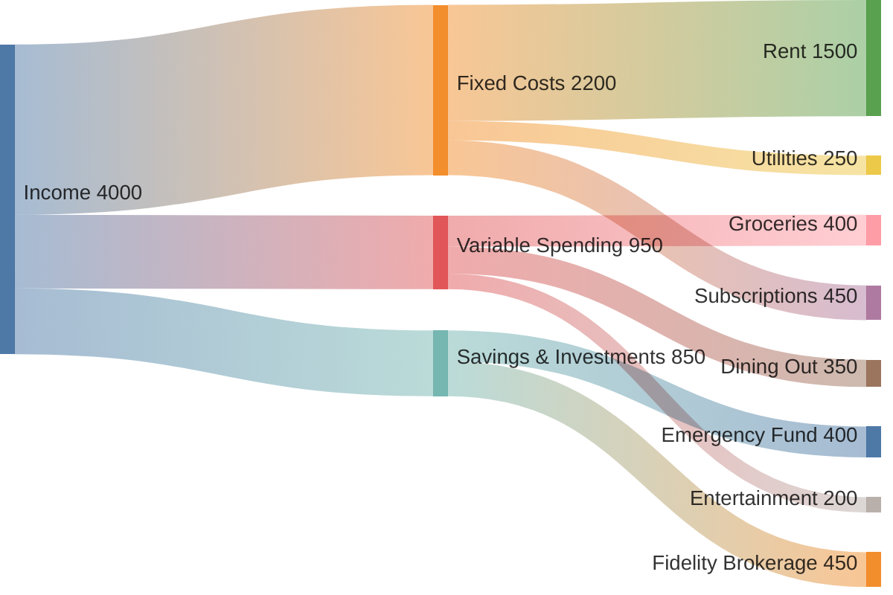

# Financial Visualization & Figure Generation Skill Guide

This skill guides your use of visual charting tools (`render_chart` and `render_diagram`) to turn raw Plaid financial data into clear, beautiful figures.

---

## ⚡ Core Directive: Proactive Chart Generation

**Do not wait for the user to explicitly ask *"Can you make a chart?"***

Whenever Matthew asks questions about his money where data has categories, percentages, balances, or trends over time:
1. **Fetch the financial data** using Plaid tools (`get_recent_transactions`, `get_financial_summary`, `get_recurring_subscriptions`, `get_liabilities`).
2. **Proactively generate an accompanying chart figure** using `render_chart` (for statistical charts) or `render_diagram` (for Sankey flow diagrams).
3. **Deliver the figure alongside a sharp, bulleted summary** of key takeaways and actionable insights.

> [!TIP]
> The generated chart artifact will automatically preview in Chad's Artifacts viewer and can be delivered as a photo on Telegram!

---

## 🎯 Intent-to-Visual Mapping

| User Query / Intent | Ideal Figure Type | Tool | Chart Configuration Type |
| :--- | :--- | :--- | :--- |
| **"Where did my money go?" / Category Spending** | Modern Donut Chart | `render_chart` | `'doughnut'` with category percentages |
| **"How is my spending trending?" / Month-over-Month** | Grouped or Stacked Bar | `render_chart` | `'bar'` across months or weeks |
| **"Can I afford this?" / Cash Flow Runway** | Area / Line Chart with Threshold | `render_chart` | `'line'` with projected balance vs. danger floor |
| **"Where is my paycheck going?" (Income to Wealth Flow)** | Sankey Diagram | `render_diagram` | `mermaid` (`sankey-beta`) |
| **"What subscriptions am I paying for?"** | Horizontal Bar Chart | `render_chart` | `'horizontalBar'` or `'bar'` (indexAxis: 'y') |
| **"What is my net worth breakdown?"** | Multi-Segment Donut or Stacked Bar | `render_chart` | Cash + Investments vs. Credit + Loans |
| **"Credit card payoff / Debt snowball"** | Burn-Down Line Chart | `render_chart` | `'line'` showing balance reduction over time |

---

## 📊 How to Call `render_chart`

### ⚡ Mode 1: Simple Mode (Recommended)
You do **not** need to build nested Chart.js JSON structures. Simply pass `chart_type`, `labels`, `data`, and a `title`:

```python
# Donut / Composition:
render_chart(
    chart_type="doughnut",
    labels=["Cash & Savings", "Investments", "Debt"],
    data=[14040.40, 5768.35, 126.83],
    title="Financial Composition"
)

# Category Spending (Bar):
render_chart(
    chart_type="bar",
    labels=["Food", "Rent", "Utilities", "Travel"],
    data=[450, 1250, 210, 320],
    title="Monthly Expenses"
)
```

---

### 🎨 Mode 2: Advanced Mode (Custom Chart.js Config)
For custom nested styling, you can pass a full `chart_config` dict:
Use whenever analyzing `get_recent_transactions`:
```json
{
  "type": "doughnut",
  "data": {
    "labels": ["Food & Drink", "Groceries", "Rent & Utilities", "Shopping", "Entertainment", "Other"],
    "datasets": [{
      "data": [450, 380, 1250, 210, 140, 95],
      "backgroundColor": [
        "#ff6384", "#36a2eb", "#4bc0c0", "#ffcd56", "#9966ff", "#c9cbcf"
      ],
      "borderWidth": 2,
      "borderColor": "#ffffff"
    }]
  },
  "options": {
    "title": {
      "display": true,
      "text": "Monthly Spending by Category ($2,525 Total)",
      "fontSize": 16,
      "fontColor": "#333333"
    },
    "legend": {
      "position": "bottom"
    },
    "plugins": {
      "doughnutlabel": {
        "labels": [
          {"text": "Total", "font": {"size": 14}},
          {"text": "$2,525", "font": {"size": 20, "weight": "bold"}}
        ]
      }
    }
  }
}
```

### 2. Recurring Subscriptions & Monthly Outflows (Horizontal Bar)
Use whenever analyzing `get_recurring_subscriptions`:
```json
{
  "type": "horizontalBar",
  "data": {
    "labels": ["Rent / Housing", "Gym / Fitness", "Spotify", "Netflix", "Cloud Storage", "Utilities"],
    "datasets": [{
      "label": "Monthly Cost ($)",
      "data": [1200, 65, 12.99, 15.49, 9.99, 140],
      "backgroundColor": "rgba(54, 162, 235, 0.7)",
      "borderColor": "rgba(54, 162, 235, 1)",
      "borderWidth": 1
    }]
  },
  "options": {
    "title": {
      "display": true,
      "text": "Recurring Monthly Outflows ($1,443.47 / mo)",
      "fontSize": 15
    },
    "legend": { "display": false },
    "scales": {
      "xAxes": [{ "ticks": { "beginAtZero": true } }]
    }
  }
}
```

### 3. Cash Flow Runway & 30-Day Liquidity Area Chart
Use whenever projecting cash flow against upcoming bills and paychecks:
```json
{
  "type": "line",
  "data": {
    "labels": ["Oct 1", "Oct 7", "Oct 14", "Oct 21", "Oct 28", "Nov 4"],
    "datasets": [
      {
        "label": "Projected Balance",
        "data": [3200, 2750, 4100, 3400, 2900, 4300],
        "borderColor": "#4bc0c0",
        "backgroundColor": "rgba(75, 192, 192, 0.2)",
        "fill": true,
        "tension": 0.3
      },
      {
        "label": "Safety Buffer ($1,000 Floor)",
        "data": [1000, 1000, 1000, 1000, 1000, 1000],
        "borderColor": "#ff6384",
        "borderDash": [5, 5],
        "fill": false,
        "pointRadius": 0
      }
    ]
  },
  "options": {
    "title": {
      "display": true,
      "text": "30-Day Liquidity Runway"
    }
  }
}
```

### 4. Net Worth & Asset vs. Liability Breakdown (Bar Chart)
Use whenever analyzing `get_financial_summary`:
```json
{
  "type": "bar",
  "data": {
    "labels": ["Cash & Checking", "Investments", "Credit Cards (Debt)", "Net Worth"],
    "datasets": [{
      "data": [4250, 18500, -2100, 20650],
      "backgroundColor": [
        "#36a2eb", "#4bc0c0", "#ff6384", "#10b981"
      ]
    }]
  },
  "options": {
    "title": { "display": true, "text": "Net Worth Balance Sheet" },
    "legend": { "display": false }
  }
}
```

---

## 🌊 Income-to-Wealth Flow Diagram (`render_diagram` with Mermaid)

For full flow visualizations (how salary flows through accounts, fixed costs, variable expenses, and savings), call `render_diagram` with `diagram_type="mermaid"` and `sankey-beta`:



---

## 📋 Response Structure

When delivering financial figures proactively, follow this clean 3-part layout:

1. **Executive Headline**: One sentence answering the direct question (e.g. *"Your total spending over the last 30 days is **$2,525.00**, led by Housing (49%) and Food (18%)."*).
2. **Visual Figure**: Proactively render the chart via `render_chart`. Highlight that the chart artifact is attached/previewed.
3. **Key Observations & Actionable Recommendations**:
   - Top merchant or biggest category spike.
   - Any upcoming recurring bills or credit card due dates.
   - A constructive suggestion (e.g., *"Dining out is up 25% this month — keeping it under $50/week for the rest of the cycle will leave an extra $200 for savings."*).
